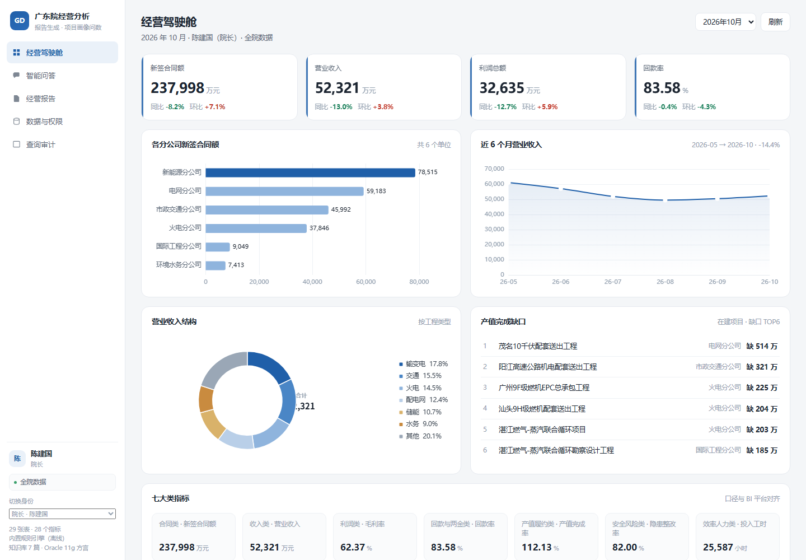
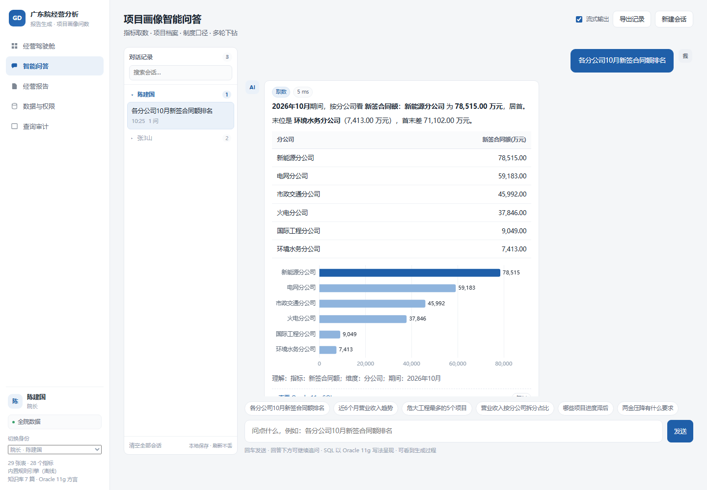
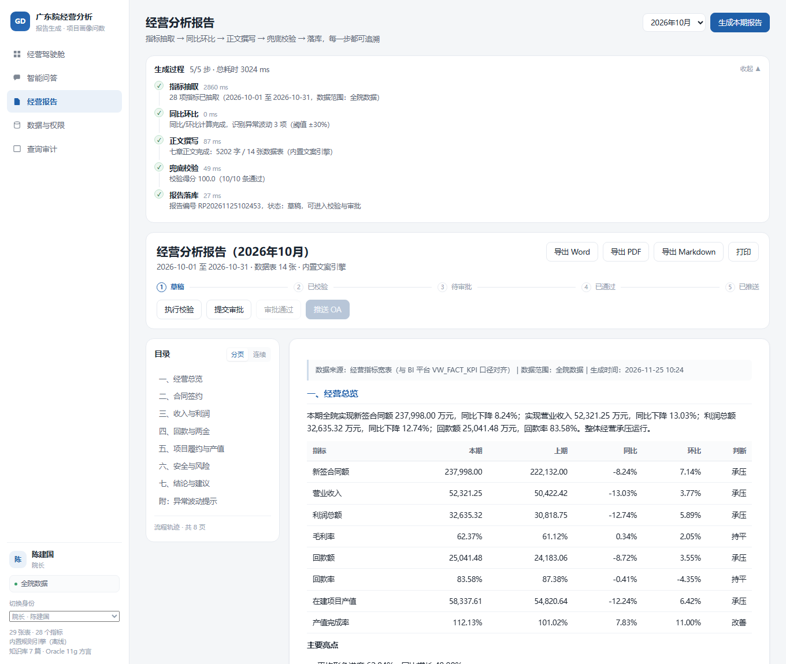
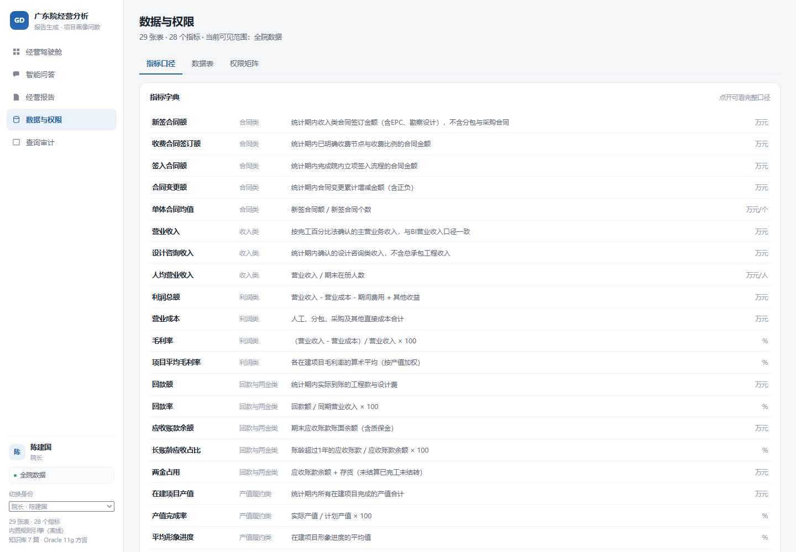
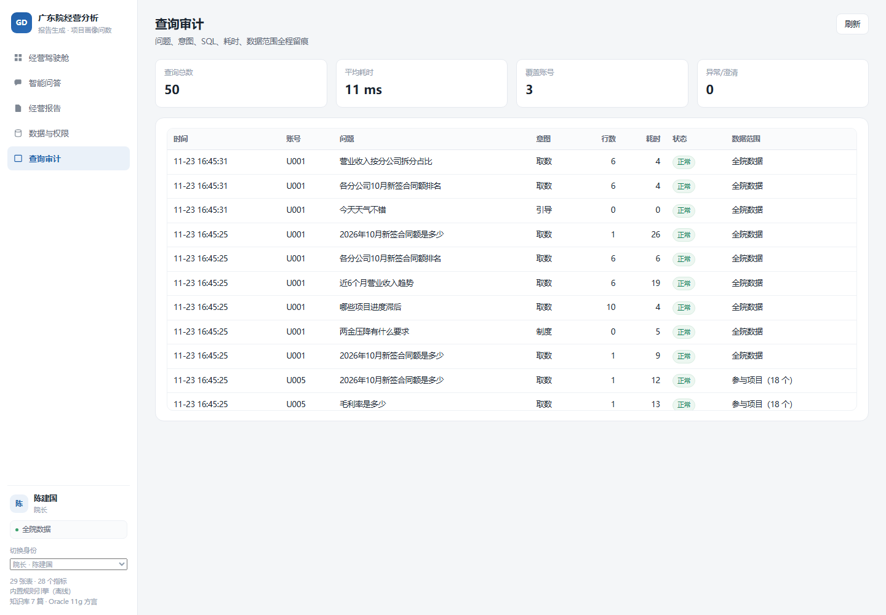
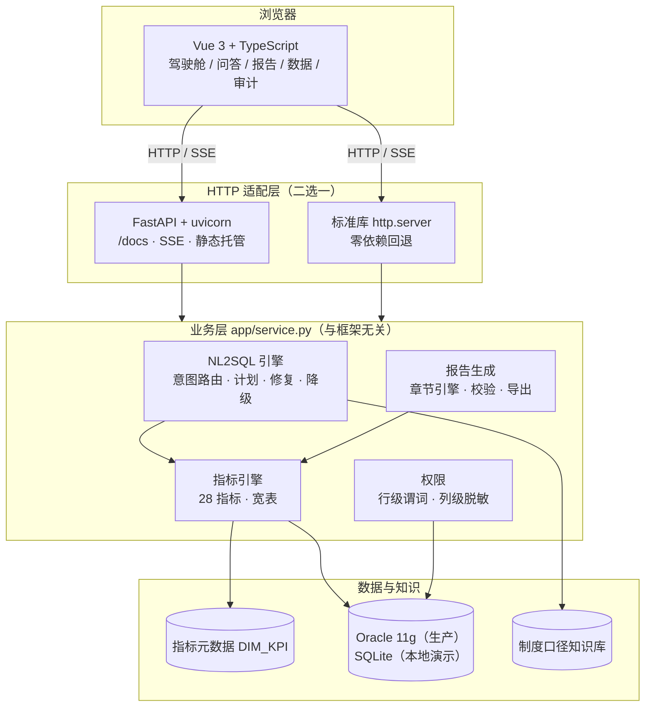

# 广东院经营分析智能问数系统

> 面向能源设计院的「经营分析报告自动生成 + 项目画像智能问答」一体化示例系统。
> 一条命令在本机跑起来：`python run.py`

[](https://www.python.org/)
[](https://fastapi.tiangolo.com/)
[](https://vuejs.org/)
[](https://www.typescriptlang.org/)
[](#测试)
[](LICENSE)

---

## 这是什么

一个**能跑、能看、能追问**的经营分析系统示例：把"人工写 SQL 取数 → 手工拼周报"的链路，换成
「自然语言提问 → 生成 Oracle SQL → 权限过滤 → 出表出图」，以及「一键生成本期经营分析报告 → 兜底校验 → 审批推送」。

它解决三个具体问题：

| 痛点 | 本项目的做法 |
|---|---|
| 指标口径散落各处，取数依赖人工写 SQL | 28 个指标声明式登记（口径 / 单位 / 归口 / SQL 片段），问答与报告共用同一套口径 |
| 经营周报重复劳动，数字容易抄错 | 七章固定体例的报告生成器 + 10 条兜底校验（数值可追溯到宽表，防幻觉） |
| 不同岗位能看到的数据不同，应用层过滤容易漏 | 行级隔离用 **SQL 谓词注入**实现，列级隔离区分财务 / 非财务岗，无法校验范围的查询直接拒绝 |

> ⚠️ 仓库内的组织、项目、合同、人员**全部是合成数据**（固定随机种子，可复现），与任何真实机构无关；
> "广东院"仅作为业务场景名称使用。

## 界面

| 经营驾驶舱 | 项目画像智能问答 |
|---|---|
|  |  |
| **经营分析报告（分页 + 生成过程可追溯）** | **数据与权限** |
|  |  |

**查询审计**（问题、意图、SQL、耗时、数据范围全程留痕）



## 功能一览

### 1. 经营分析报告自动生成

- **七章固定体例**：经营总览 / 合同签约 / 收入与利润 / 回款与两金 / 项目履约与产值 / 安全与风险 / 结论与建议
- **文字 + 表格混排**：每章「结论句 → 明细数据表 → 分析 → 措施」，单篇约 13–14 张表
- **生成过程可追溯**：指标抽取 → 同比环比 → 正文撰写 → 兜底校验 → 落库，五步各自耗时，SSE 实时推进，轨迹随报告落库
- **10 条兜底校验**：章节完整性、单位规范、数字格式、指标一致性、数值可追溯（防幻觉）、异常波动说明、安全红线……
- **分页与导出**：按章分页阅读，导出 Word（每章分页 + 页码域）/ PDF（嵌入中文字体）/ 可打印 HTML / Markdown
- **审批推送链路**：草稿 → 已校验 → 待审批 → 已通过 → 已推送，每次流转写审批记录，推送返回回执号

### 2. 项目画像智能问答（NL2SQL）

- **多分支意图路由**：自然语言取数 / 项目档案检索 / 制度口径问答 / 澄清反问 / 闲聊引导
- **Oracle 11g 方言**：SQL 以 11g 写法生成与展示（`ROWNUM`、`NVL`、`TO_CHAR`），三层方言层负责生成、校验与本地转译
- **修复与降级**：语法 / 字段错误自动捕获 → 定向改写 → 重试（最多 3 轮）→ 仍失败则降级查指标宽表，界面标注"已降级"
- **多轮与下钻**：回答下方给出可点击的追问建议；支持"再看环比""按分公司拆"这类指代
- **图表联动**：条形 / 折线 / 环形图由后端返回图表规格，前端 ECharts 渲染
- **流式输出**：SSE 推送意图、指标与 SQL 逐字生成过程，SQL 可一键复制

### 3. 权限与审计

- **行级**：院长 / 副院长 / 财务专员看全院；分公司负责人看本分公司；部门负责人看本部门；项目经理 / 工程师看参与项目
- **列级**：利润与成本类指标对非财务岗位脱敏（`***（无权限）`），报告中的利润章节同步剔除
- **拒绝越权**：查询若不含项目维度、无法完成范围校验，直接拒绝执行而不是返回全量
- **审计留痕**：问题、意图、SQL、返回行数、耗时、数据范围全程记录

### 4. 数据底座

- **29 张表**：9 张维表 + 18 张事实表 + 2 张关联表，覆盖合同、收入、成本、回款、应收账龄、产值、进度、风险、危大工程、工时、报告与行政审批
- **28 个指标 / 7 大类**：合同、收入、利润、回款两金、产值履约、安全风险、效率人力
- **演示数据**：300 个项目、500+ 合同、约 2 万条事实，覆盖 2025-01 ~ 2026-10，同比环比齐备
- **知识库**：7 篇制度与口径文档（指标口径手册、两金压降办法、报告编制规范、权限管理办法…）

## 快速开始

### 方式 A：零依赖跑起来（推荐先体验）

只需要 **Python 3.10+**，不装任何第三方包：

```bash
git clone <your-repo-url> gdjy
cd gdjy
python run.py
```

首次运行自动建库、造数、构建指标宽表，然后打开 <http://127.0.0.1:8848>。
前端构建产物已随仓库提交，无需 Node。

### 方式 B：启用 FastAPI 与 Word / PDF 导出

```bash
pip install -r requirements.txt     # fastapi / uvicorn / python-docx / reportlab
python run.py                       # 自动优先使用 FastAPI，多出 /docs 交互文档
```

若 `pip` 访问 PyPI 受限，可只装到仓库内的 `_pydeps/`（不污染全局环境，`run.py` 会自动识别）：

```bash
pip install --target ./_pydeps fastapi uvicorn python-docx reportlab
python run.py
```

强制指定服务器：`python run.py --server fastapi` 或 `--server stdlib`。

### 方式 C：前端开发模式（热更新）

```bash
# 终端 1
python run.py --port 8848

# 终端 2
cd frontend
npm install          # 国内网络可加 --registry=https://registry.npmmirror.com
npm run dev          # http://localhost:5173，/api 已代理到 8848
```

改完前端执行 `npm run build`，产物输出到 `web/`（Vite 已配置），后端无需重启。

### 常用命令

```bash
python run.py --reset          # 重建演示数据
python run.py --init-only      # 只初始化，不启动服务
python tests/test_smoke.py     # 后端端到端自检（36 项）
cd frontend && npm test        # 前端单元测试（51 项）
```

## 架构



关键设计：**HTTP 只做协议适配，业务全在 `app/service.py`**。因此同一个系统既能跑在 FastAPI 上，
也能在没装任何依赖的机器上用标准库跑；换成 Flask / Django 只需重写一层路由映射（约 60 行）。

- 调用链、权限模型、生产替换点 → [docs/architecture.md](docs/architecture.md)
- 关键取舍与理由 → [docs/decisions.md](docs/decisions.md)
- 接口清单与 SSE 协议 → [docs/api.md](docs/api.md)
- 需求逐条对照 → [docs/requirements-mapping.md](docs/requirements-mapping.md)

## 主要接口

| 方法 | 路径 | 说明 |
|---|---|---|
| GET | `/api/meta` | 账号、指标数、表数、导出能力 |
| GET | `/api/dashboard?user_id=&start=&end=` | 驾驶舱数据（卡片 + 图表 + 风险清单） |
| POST | `/api/ask` | 自然语言问答 |
| POST | `/api/ask/stream` | 问答 SSE：`stage` → `sql`（逐字）→ `result` |
| POST | `/api/report/build` | 生成经营分析报告 |
| POST | `/api/report/stream` | 生成进度 SSE（五步 running → ok） |
| POST | `/api/report/validate` | 执行 10 条兜底校验 |
| POST | `/api/report/action` | 提交审批 / 审批通过 / 推送 OA |
| GET | `/api/report/export?id=&fmt=` | 导出 `md` / `docx` / `pdf` / `html` |
| GET | `/api/table/{name}` | 表结构、样例数据、相关指标与关联表 |
| GET | `/api/audit?limit=` | 查询审计日志 |

完整参数、SSE 事件格式与 `curl` 示例见 [docs/api.md](docs/api.md)。

## 目录结构

```text
gdjy/
├── run.py                      # 一键启动：建库 → 造数 → 建宽表 → 起服务
├── requirements.txt            # 可选依赖（不装也能跑）
├── server/fastapi_app.py        # FastAPI 适配层（路由 + SSE + 静态托管）
├── app/
│   ├── service.py              # 业务服务层（HTTP 框架无关）
│   ├── api.py                  # 标准库 HTTP 适配层（零依赖回退）
│   ├── config.py               # 期间、路径、权限角色等配置
│   ├── db.py / seed.py         # 连接与演示数据生成（固定种子）
│   ├── metrics.py              # 28 个指标元数据 + 指标宽表
│   ├── permission.py           # 行级谓词注入、列级脱敏、范围描述
│   ├── oracle_compat.py        # Oracle 11g 方言：lint / rewrite / to_sqlite
│   ├── kb.py                   # 制度口径知识库（BM25 字符二元组检索）
│   ├── dashboard.py            # 驾驶舱聚合
│   ├── nl2sql/                 # 词表、提示词、计划器、修复回路、路由
│   └── report/
│       ├── builder.py          # 报告编排 + 五步轨迹
│       ├── sections.py         # 七章正文：结论句 + 数据表 + 分析 + 措施
│       ├── validator.py        # 10 条兜底校验
│       ├── export.py           # Word / PDF / HTML 导出（共用一套解析）
│       └── workflow.py         # 审批与推送状态机
├── frontend/                   # Vue 3 + TS + Vite + ECharts
│   └── src/{views,components,stores,api,utils}
├── web/                        # 前端构建产物（随仓库提交，便于直接运行）
├── data/kb/                    # 7 篇制度与口径文档
├── tests/test_smoke.py         # 后端端到端自检
└── docs/                       # 架构、接口、取舍说明与界面截图
```

## 测试

```bash
# 后端：端到端 36 项（取数、权限隔离、SQL 修复、报告生成与校验、导出、审批链路）
python tests/test_smoke.py

# 前端：单元测试 51 项 + 类型检查
cd frontend
npm run type-check
npm test
```

| 覆盖层 | 内容 |
|---|---|
| 后端自检 36 项 | 28 指标可取数、权限范围隔离、非财务岗脱敏、报告生成 / 校验 / 审批 / 推送、生成轨迹 5 步、Word / PDF / HTML 导出、知识库检索、意图路由 |
| 前端单测 51 项 | 数字与百分比格式化、Markdown 渲染与转义、ECharts 配置、SSE 解析（含跨分片）、聊天消息、审批步进器、表结构抽屉、多会话管理、会话导出、身份分组 |

CI（[.github/workflows/ci.yml](.github/workflows/ci.yml)）在每次 push / PR 上跑后端自检与前端类型检查、单测、构建。

## 已知边界

- **本地执行引擎是 SQLite**：仅为"克隆即可跑"。SQL 全程按 Oracle 11g 生成并展示，生产替换执行器即可。
- **意图路由是规则 + 词表驱动**：未接大模型时的确定性实现，覆盖面有限；接模型后走 `nl2sql/llm.py` 的同一套修复与校验链路。
- **PDF 导出依赖系统中文字体**：Windows 用微软雅黑，Linux 需安装（如 `fonts-wqy-zenhei`），缺字体时自动降级为 HTML 打印。
- **演示数据是合成的**：用于展示指标口径与链路，不适合直接做业务结论。

## Roadmap

- [ ] 指标口径的可视化编辑器（现在改口径要改 `metrics.py`）
- [ ] 报告模板可配置（章节顺序、必填指标、审批流）
- [ ] NL2SQL 增加 BIRD 风格评测集，量化规则引擎与模型模式的差距
- [ ] 语义层 + 向量检索的混合 schema linking
- [ ] 多租户与真实权限中心对接示例

## 贡献

欢迎提 Issue 与 PR。提交前请先看 [CONTRIBUTING.md](CONTRIBUTING.md)（开发环境、提交规范、检查清单）。
安全问题请按 [SECURITY.md](SECURITY.md) 的方式私下反馈。

## License

[MIT](LICENSE) © 2026 GDJY Contributors
